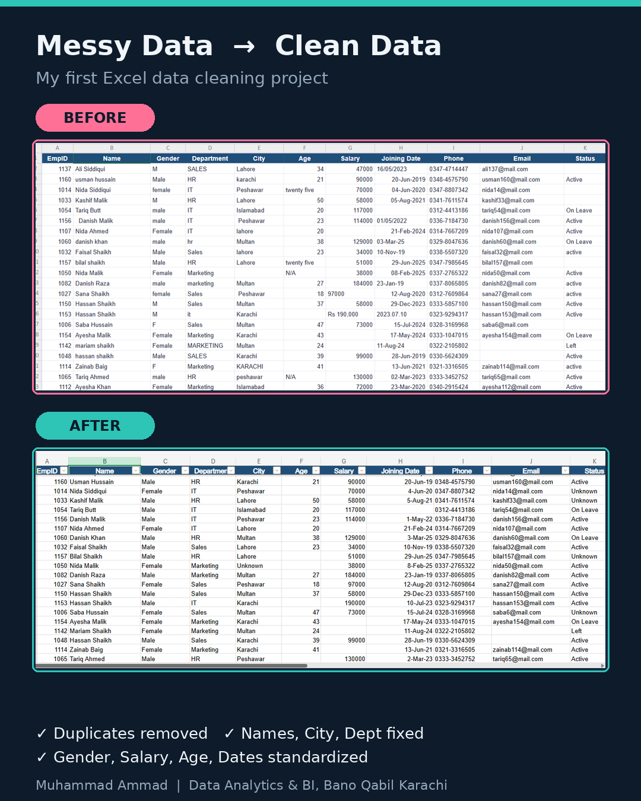

# Excel Data Cleaning Project

Cleaning a messy employee dataset (192 rows) in Excel to make it ready for analysis.

## Problems found in the raw data
- 12 duplicate rows
- Inconsistent text (karachi / KARACHI / Karachi, IT / it / I.T)
- Extra spaces in names
- Gender written as M, F, male, female
- Salary stored as text (e.g. "Rs 131,000")
- Age containing text (N/A, "twenty five")
- 4 different date formats
- Blank cells in City, Phone and Status

## What I did
- Removed duplicates (192 rows became 180 rows)
- Fixed names and city using TRIM and PROPER
- Standardized Department with Find and Replace
- Standardized Gender using IF, UPPER and LEFT
- Converted Salary to numbers using VALUE and SUBSTITUTE
- Cleaned Age using IF and ISNUMBER
- Converted all dates to one format (dd-mmm-yyyy)
- Replaced blanks with "Unknown" where needed

## Tools used
Microsoft Excel: formulas, Remove Duplicates, Find and Replace, Paste Values

## Files
- `excel_filter_practice_messy.xlsx` = original messy data
- `excel_filter_practice_cleaned.xlsx` = final cleaned data
- `before_after.png` = comparison picture

## What I learned
Real data is always messy. Cleaning it carefully is the most important step before any analysis or dashboard.

## Author
Muhammad Ammad | Graphic Designer and Data Analytics student, Bano Qabil, Karachi
